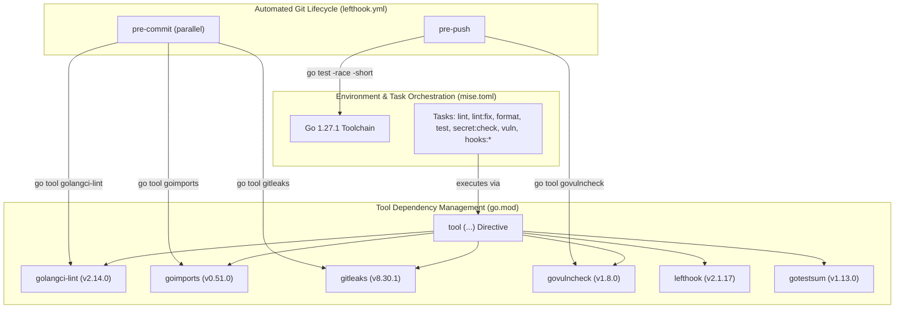

# ADR-0001: Standardized Development Environment and Tooling Pipeline

## Status
Accepted

## Date
2026-10-05

## Context
A major challenge in multi-developer Go projects is maintaining reproducible local development environments, uniform code quality, and proactive security controls across diverse workstations and CI pipelines.

Historically, Go projects suffered from several friction points:
1. **Tooling Version Drift**: Installing developer utilities globally via `go install <pkg>@latest` led to disparate versions across team members, producing inconsistent linting results and formatting conflicts.
2. **Ad-hoc Workarounds (`tools.go`)**: Before Go introduced native tool tracking, teams maintained artificial Go files with blank imports (`_ "github.com/..."`) guarded by build tags (`//go:build tools`) to pin tool versions in `go.mod`.
3. **Fragmented Task Execution**: Relying on disparate Makefiles, complex bash scripts, or unmanaged shell commands increased developer onboarding overhead and reduced cross-platform portability.
4. **Late Feedback Loops**: Linting errors, formatting inconsistencies, committed credentials/secrets, and vulnerable dependencies were often caught late in the delivery pipeline (during pull request CI or staging deployments) rather than directly on the developer's workstation.

We require a standardized, self-contained, and automated development workflow that guarantees deterministic tool versions, minimizes setup friction, and shifts quality and security checks left.

## Decision
We establish a standardized development environment combining **Mise** for runtime and task management, **Go native `tool` directive** for developer tooling dependencies, and **Lefthook** for automated Git hooks.

### 1. Toolchain & Task Management via Mise (`mise.toml`)
- **Pinned Runtime**: Go runtime is strictly pinned to `1.27.1` in `mise.toml`. Mise ensures all developers and automation agents use the exact same compiler version without polluting system paths.
- **Unified Task Runner**: All recurring development workflows are declared as Mise tasks calling isolated `go tool` invocations:
  - `mise run lint`: Runs `golangci-lint` over all packages (`./...`).
  - `mise run lint:fix`: Executes `golangci-lint` with automated rule corrections (`--fix`).
  - `mise run format`: Applies `goimports` formatting and import optimization across non-vendored Go files.
  - `mise run secret:check`: Runs local standalone secret scanning via `gitleaks`.
  - `mise run test`: Executes unit tests with race detection and human-readable formatting via `gotestsum`.
  - `mise run vuln`: Checks for known vulnerabilities in dependencies via `govulncheck`.
  - `mise run hooks:install` / `hooks:uninstall` / `hooks:check`: Manages local Git lifecycle hooks.

### 2. Native Tool Dependency Tracking via `go.mod`
We leverage Go's native `tool` directive in `go.mod` to declare and version-control developer CLI binaries alongside project dependencies:
- **`github.com/golangci/golangci-lint/v2/cmd/golangci-lint`**: Aggregates multi-linter static analysis governed by `.golangci.yml` (enforcing error handling, complexity bounds, code style, and security).
- **`golang.org/x/tools/cmd/goimports`**: Enforces canonical Go formatting and organizes import groupings.
- **`github.com/zricethezav/gitleaks/v8`**: Inspects files and commit history for inadvertently hardcoded API keys, passwords, and sensitive tokens.
- **`golang.org/x/vuln/cmd/govulncheck`**: Queries the official Go vulnerability database to surface known CVEs and security advisories in reachable call graphs.
- **`gotest.tools/gotestsum`**: Runs Go tests with structured, human-readable terminal output (`--format testname`) and summary reporting.
- **`github.com/evilmartians/lefthook/v2`**: Provides fast, dependency-free Git hooks orchestration.
- **`github.com/fullstorydev/grpcurl/cmd/grpcurl`**: Provides CLI introspection, health-checking, and interactive RPC testing for gRPC servers via reflection without requiring global tools.
Each tool dependency is cryptographically pinned in `go.sum` and executed directly via `go tool <command>`, eliminating the need for pre-installed global binaries.

### 3. Shift-Left Quality & Security via Lefthook (`lefthook.yml`)
Git hooks automate validation at critical developer boundaries:
- **`pre-commit` (executed concurrently)**:
  - `gitleaks`: Scans staged changes to block credential leaks before commits are recorded.
  - `goimports`: Formats staged files and automatically restages modified buffers.
  - `golangci-lint`: Performs differential linting (`--new-from-rev=HEAD~1`) on modified files to keep local commit cycles fast.
- **`pre-push`**:
  - `unit-tests`: Executes fast unit tests with race detection (`go test -race -short ./internal/...`).
  - `govulncheck`: Verifies that no known vulnerabilities exist in dependencies before pushing upstream.

## Consequences

### Positive
- **Reproducibility**: Exact compiler and tool binaries are locked across developer machines and continuous integration workers.
- **Zero Global Pollution**: Developers do not need to globally install `golangci-lint`, `goimports`, `gitleaks`, `gotestsum`, or `lefthook` on their host machines.
- **Shift-Left Security & Cleanliness**: Committing secrets or pushing unvetted vulnerabilities is prevented locally before remote branch publication.
- **High Performance**: Pre-commit tasks run in parallel; linting focuses on modified changesets to minimize commit latency.
- **Single Developer Interface**: Developers execute straightforward commands (`mise run <task>`) rather than remembering underlying flags or shell pipelines.

### Negative
- **Initial Invocation Latency**: The first execution of each tool triggers Go module resolution and compilation into the local Go build cache.
- **Hook Overhead**: Git commits and pushes perform static validation, adding slight processing time (typically sub-second to a few seconds).

### Neutral
- Developers are strongly encouraged to use `mise` for environment setup, but can still invoke commands directly using `go tool <name>` if working in environments without Mise installed.

## Alternatives Considered

1. **Global `go install` Scripts with `Makefile`**:
   - *Rejected*: Prone to version divergence when contributors update tools at different times. Pollutes `$GOPATH/bin` across projects.
2. **Traditional `tools.go` Pattern**:
   - *Rejected*: Obsolete with Go native `tool` directive support, which provides first-class compiler and module tracking without dummy packages or build tags.
3. **Python-based `pre-commit` Framework**:
   - *Rejected*: Introduces an external Python runtime dependency into a Go codebase. Lefthook is distributed directly as a Go tool, starts faster, and natively supports parallel step execution.
4. **Containerized Devcontainers Only**:
   - *Rejected*: While fully isolated, running all daily edit-lint-format cycles inside Docker introduces resource overhead and IDE latency on macOS workstations. Combining Mise with native `go tool` provides equivalent reproducibility with native host performance.

## References
- [Go Modules: Tool Dependencies Directive](https://go.dev/doc/modules/managing-dependencies#tools)
- [Mise Development Tool & Task Manager](https://mise.jdx.dev/)
- [Lefthook Git Hooks Manager](https://github.com/evilmartians/lefthook)
- [GolangCI-Lint Documentation](https://golangci-lint.run/)
- [Gitleaks Secret Scanner](https://github.com/zricethezav/gitleaks)
- [Govulncheck Vulnerability Scanner](https://pkg.go.dev/golang.org/x/vuln/cmd/govulncheck)
- [gotestsum Test Runner](https://github.com/gotestyourself/gotestsum)
