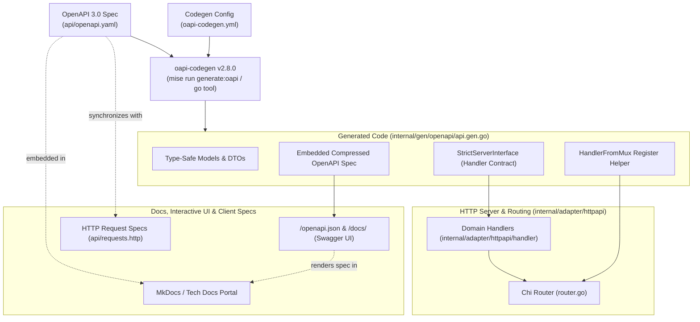

# ADR-0002: OpenAPI Specification-First Architecture with oapi-codegen and Chi

## Status
Accepted

## Date
2026-10-06

## Context
When designing HTTP APIs in Go, development teams frequently face contract divergence between documentation and actual implementation:

1. **Code-First / Manual Drift**: Writing HTTP routing handlers and struct types by hand inevitably causes API contracts to drift from separate documentation, Swagger files, or client expectations.
2. **Untyped Handlers & Runtime Breakages**: Hand-written Chi or standard library routing logic often relies on manual path parameter parsing, body deserialization, and untyped query parameter handling, deferring structural contract failures to runtime.
3. **Decoupled API Documentation & Client Tooling**: Maintaining independent documentation (such as static Markdown or external API portals) introduces toil and quickly becomes obsolete as endpoints evolve.
4. **Tooling & Code Generation Friction**: Tooling that generates code must be deterministic, version-controlled, and easily reproducible across developer machines and automated pipelines without requiring ad-hoc manual scripts or global binary installations.

We need an API architecture that enforces a single source of truth for all HTTP contracts, guarantees compile-time type safety for routing interfaces, and seamlessly integrates with developer tooling, interactive documentation (Swagger UI), and HTTP client request specs.

## Decision
We adopt an **OpenAPI 3.0 specification-first** approach utilizing **`oapi-codegen`** to generate Go Chi server interfaces and models directly from `api/openapi.yaml`.

The OpenAPI specification serves as the authoritative single source of truth across the application lifecycle:

### 1. Specification as the Single Source of Truth
- The API contract is authored and maintained in `api/openapi.yaml` using OpenAPI 3.0.
- All endpoints (e.g. `GET /healthz`), query parameters, request bodies, and response envelopes are formally defined here prior to or alongside implementation.

### 2. Automated Generation with `oapi-codegen`
- Code generation is governed by `oapi-codegen.yml`:
  - `package: openapi`
  - `output: internal/gen/openapi/api.gen.go`
  - `generate.models: true`: Emits Go structs for schema objects with JSON tags.
  - `generate.chi-server: true`: Emits Chi HTTP routing scaffolding and `HandlerFromMux`.
  - `generate.strict-server: true`: Emits typed `StrictServerInterface` preventing untyped request/response errors.
  - `generate.embedded-spec: true`: Embeds the gzip-compressed OpenAPI specification binary directly into the generated Go package via `GetSpec()`.
- Generator task is tracked as a native Go tool directive (`github.com/oapi-codegen/oapi-codegen/v2/cmd/oapi-codegen`) and executed via `mise run generate:oapi`.

### 3. Compile-Time Type-Safe Router Integration
- HTTP handlers implement the generated `ServerInterface`. If the OpenAPI schema changes, compile errors immediately surface missing or altered handler signatures.
- Handlers are registered cleanly onto Chi using `generated.HandlerFromMux(server, router)`.

### 4. Embedded Interactive Documentation & Client Specs
- The embedded spec powers the `/openapi.json` endpoint at runtime via `openapi.GetSpec()`.
- Interactive Swagger UI is hosted at `/docs/` with pinned vendored assets (no external CDN) and gated away from production environments.
- Ready-to-use HTTP client request files (`api/requests.http`) mirror the schema for direct workstation testing and IDE execution.
## Consequences

### Positive
- **Single Source of Truth**: Eliminates manual synchronization between documentation and server code.
- **Compile-Time Contract Safety**: Any change in OpenAPI parameters, payloads, or paths directly enforces corresponding handler updates at compile time.
- **Embedded Zero-Drift Documentation**: Swagger UI and OpenAPI JSON endpoints are served directly from the compiled binary with vendored assets, zero CDN dependencies, and strict Content-Security-Policy headers.
- **Deterministic Tooling**: Version-pinned via `go.mod` `tool` directive (`v2.8.0`) and callable via `mise run generate:oapi`.
- **Streamlined Client Generation**: The exact same specification can generate client SDKs, mock servers, or test suites.

### Negative
- **Generated Code Overhead**: Requires committing or regularly generating `internal/gen/openapi/api.gen.go` (managed via CI/Mise tasks).
- **OpenAPI Learning Curve**: Schema changes require editing YAML and understanding OpenAPI 3.0 constructs rather than directly modifying Go struct definitions.

### Neutral
- Schema changes require running `mise run generate:oapi` before implementing handlers, slightly altering the developer workflow into an intentional design-first cadence.

## Alternatives Considered

1. **Code-First Annotations (e.g., `swaggo/swag`)**:
   - *Rejected*: Declarative comment annotations on handlers are fragile, prone to syntax errors, decouple types from strict schema validation, and frequently fall out of sync with real HTTP behavior.
2. **Hand-Written Chi Handlers without Generation**:
   - *Rejected*: Manual parameter unpacking and untyped error handling create boilerplate, runtime type mismatch vulnerabilities, and duplicate schema documentation maintenance.
3. **Alternative Frameworks / RPC-First (e.g., gRPC-Gateway, Twirp)**:
   - *Rejected*: OpenAPI 3.0 provides standard REST/HTTP compatibility, broad ecosystem support, embedded Swagger UI capability, and standard HTTP tooling without mandatory Protobuf compilation pipelines for this service tier.

## References
- [OpenAPI Specification v3.0.3](https://spec.openapis.org/oas/v3.0.3)
- [oapi-codegen GitHub Repository](https://github.com/oapi-codegen/oapi-codegen)
- [Go Chi Router](https://github.com/go-chi/chi)
- ADR-0001: Standardized Development Environment and Tooling Pipeline
