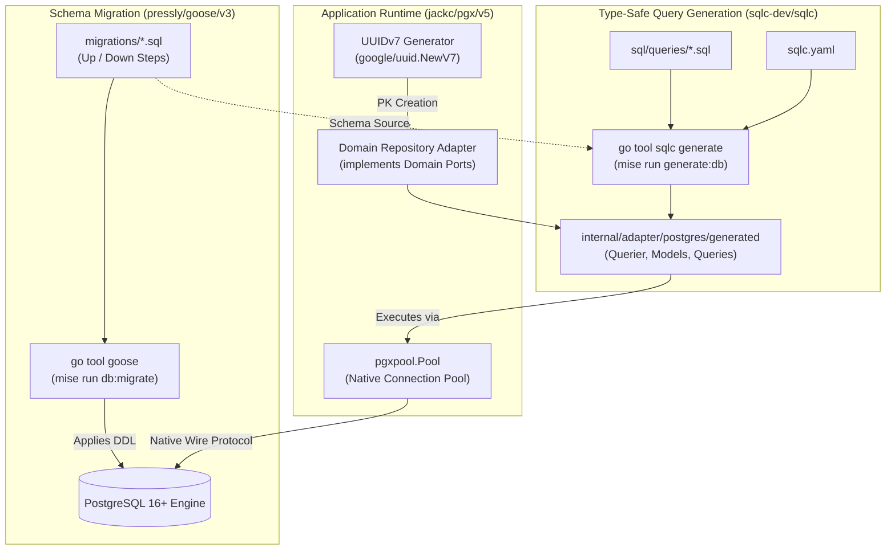

# ADR-0003: PostgreSQL Persistence Layer Architecture with pgx/v5, sqlc, goose, and UUIDv7

## Status
Accepted

## Date
2026-10-06

## Context
A critical architectural component of the hotel booking system is its persistence layer. The domain handles concurrent reservation workflows, inventory allocation, room availability searches, and transactional payment/booking states. These operations demand strong consistency (ACID), predictable query performance, type safety, and schema evolvability.

Historically, Go database layers encounter common architectural failure modes:

1. **Heavy Object-Relational Mappers (ORMs like GORM or Ent)**:
   - Introduce hidden reflection overhead, unpredictable N+1 query patterns, and leaky abstraction layers over SQL.
   - Abstract away database-specific capabilities (e.g., PostgreSQL JSONB, CTEs, advisory locks, `FOR UPDATE SKIP LOCKED`).
2. **Untyped Raw SQL (`database/sql` + manual scanning)**:
   - Error-prone manual `Rows.Scan(&var...)` leading to column order mismatch bugs and missed NULL checks.
   - SQL query syntax errors and type drift are only caught at runtime instead of compile time.
3. **Identifier Contention and B-Tree Index Fragmentation (Random UUIDv4 vs. Sequential Auto-Increment)**:
   - Sequential `BIGSERIAL` / auto-increment IDs leak business metrics (order/booking volumes) and present enumeration vulnerabilities.
   - Random `UUIDv4` keys cause severe B-Tree index fragmentation and cache misses in high-write transactional tables because inserts are randomly scattered across disk pages.
4. **Ad-Hoc Schema Changes**:
   - Applying migrations manually or embedding uncontrolled schema mutators directly in application bootstrap creates drift between local environments, staging, and production.

We require a PostgreSQL persistence architecture that guarantees compile-time type-safe query generation, high-performance native connection pooling, disciplined schema migrations via Go toolchains, and time-ordered globally unique identifiers.

## Decision
We adopt **PostgreSQL** as our primary relational database, architected around four foundational components:

1. **`jackc/pgx/v5`**: Pure Go native driver and high-performance connection pool (`pgxpool`).
2. **`sqlc-dev/sqlc`**: Compile-time type-safe Go code generator from idiomatic SQL queries.
3. **`pressly/goose/v3`**: Declarative, version-controlled SQL migration toolchain.
4. **`UUIDv7`**: Time-ordered, k-sortable 128-bit identifiers for all entity primary keys.



---

### 1. Connection Driver & Pooling: `jackc/pgx/v5`
- We use `github.com/jackc/pgx/v5` with `pgxpool.Pool` rather than Go's standard `database/sql` wrapper with `lib/pq`.
- **Performance & Protocol Efficiency**: Native PostgreSQL wire protocol support (binary format transmission, prepared statement caching, pipelining).
- **PostgreSQL Features**: Native support for composite types, arrays, JSONB, native notifications (`LISTEN`/`NOTIFY`), and copy protocol (`pgx.CopyFrom`).
- **Connection Lifecycle Management**: Fine-grained pool sizing (`MaxConns`, `MinConns`, `MaxConnLifetime`, `MaxConnIdleTime`, `HealthCheckPeriod`) configured via environment variables.

---

### 2. Type-Safe Persistence Contract: `sqlc-dev/sqlc`
- Developers write pure, idiomatic PostgreSQL queries in `sql/queries/*.sql`.
- `sqlc` parses the migration DDL (`migrations/*.sql`) and queries, performs static SQL analysis and type deduction, and generates pure Go structs and query methods:
  - Generates `Querier` interface, model structs, and query execution methods.
  - Zero runtime reflection or overhead; performance matches hand-optimized Go code.
  - Query compilation breaks the build if a column is missing, renamed, or type-incompatible, shifting schema validation entirely left to compile time.
- Integrated into project tooling via `tool ( github.com/sqlc-dev/sqlc/cmd/sqlc )` in `go.mod` and runnable via `go tool sqlc` / `mise run generate:db`.

---

### 3. Versioned Schema Migrations: `pressly/goose/v3`
- Database schema changes are exclusively managed through sequential, versioned SQL migration files under `migrations/`:
  - Format: `<timestamp>_<description>.sql` with explicit `-- +goose Up` and `-- +goose Down` blocks.
- Managed as a tracked Go tool directive (`github.com/pressly/goose/v3/cmd/goose`) and executed via `go tool goose` / `mise run db:migrate`.
- Goose ensures zero drift between CI pipelines, developer environments, and target production databases with transparent rollback capabilities.

---

### 4. Entity Identifier Standard: UUIDv7
Every entity created in the system (e.g. `Booking`, `Room`, `Hotel`, `Guest`) must use **UUIDv7** (RFC 9562) as its primary identifier.

#### Why UUIDv7?
- **B-Tree Locality & Insert Performance**: UUIDv7 encodes a Unix timestamp in milliseconds in its most significant 48 bits, followed by version, sequence/sub-millisecond bits, and cryptographically secure random bits. Because values are monotonically increasing (k-sortable), new index entries append to the right edge of B-Tree leaf pages, virtually eliminating page splits and index fragmentation caused by random UUIDv4 keys.
- **Safety Against Enumeration**: Unlike sequential integers (`BIGSERIAL`), UUIDv7 values cannot be easily guessed, enumerated, or used by competitors to deduce business volumes.
- **Client/Distributed Creation**: IDs can be generated safely in the application layer before round-tripping to the database, enabling atomic aggregate construction and out-of-order event streaming.
- **PostgreSQL Native Compatibility**: Stored natively in PostgreSQL's compact 16-byte `UUID` data type, preserving indexing efficiency.
- **Go Implementation**: Generated using standard library compliant `github.com/google/uuid` via `uuid.NewV7()`.

```sql
-- Migration DDL convention
CREATE TABLE bookings (
    id UUID PRIMARY KEY, -- Populated with UUIDv7
    hotel_id UUID NOT NULL,
    customer_id UUID NOT NULL,
    total_amount NUMERIC(12, 2) NOT NULL,
    currency VARCHAR(3) NOT NULL,
    status VARCHAR(32) NOT NULL,
    created_at TIMESTAMPTZ NOT NULL DEFAULT clock_timestamp(),
    updated_at TIMESTAMPTZ NOT NULL DEFAULT clock_timestamp()
);

CREATE INDEX idx_bookings_hotel_created ON bookings (hotel_id, id DESC);
```

---

## Consequences

### Positive
- **Compile-Time Contract Guarantees**: Schema modifications and query syntax errors are detected at build time via `sqlc`, eliminating database runtime scanning panics.
- **Peak Runtime Performance**: `pgx/v5` bypasses `database/sql` interface overhead and operates directly over binary PostgreSQL protocols.
- **Optimal Storage & Index Layout**: UUIDv7 maintains the index locality of sequential IDs while preserving the distributed uniqueness and security of UUIDs.
- **No ORM Obfuscation**: Developers write readable, reviewable PostgreSQL statements, fully utilizing window functions, CTEs, and row-level locks without fighting an ORM abstraction.
- **Deterministic Migrations**: Goose migrations provide auditable, reproducible schema evolution across all development and production tiers.

### Negative
- **Two-Step Workflow for Queries**: Updating a database query requires modifying SQL and running `go tool sqlc generate` before Go code can reference the changes.
- **Clock Dependency for Monotonicity**: UUIDv7 ordering relies on system clock accuracy (sub-millisecond collision resolution is handled by standard sequence bits).

### Neutral
- Schema changes are maintained as raw SQL rather than Go structs or DSLs, requiring developers to be comfortable with native PostgreSQL DDL and constraints.

---

## Alternatives Considered

1. **GORM / Ent ORM**:
   - *Rejected*: Incurs significant performance penalties due to reflection, creates complex mental models around relationship hooks, and obscures PostgreSQL execution plans and indexing behavior.
2. **Standard `database/sql` + `lib/pq`**:
   - *Rejected*: `lib/pq` is officially in maintenance mode and lacks support for modern PostgreSQL features, performance optimizations, and protocol enhancements provided by `pgx/v5`.
3. **UUIDv4 (Random UUID)**:
   - *Rejected*: Random distribution destroys B-Tree cache locality under high transaction throughput, drastically increasing I/O and index page splits.
4. **Sequential `BIGINT` / `BIGSERIAL`**:
   - *Rejected*: Exposes sequential enumeration security vulnerabilities and complicates distributed entity instantiation prior to database inserts.

---

## References
- [RFC 9562: Universally Unique IDentifiers (UUIDv7)](https://www.rfc-editor.org/rfc/rfc9562.html)
- [jackc/pgx Documentation](https://github.com/jackc/pgx)
- [sqlc Documentation](https://docs.sqlc.dev/en/stable/)
- [pressly/goose Documentation](https://github.com/pressly/goose)
- ADR-0001: Standardized Development Environment and Tooling Pipeline
- ADR-0002: OpenAPI Specification-First Architecture with oapi-codegen and Chi
