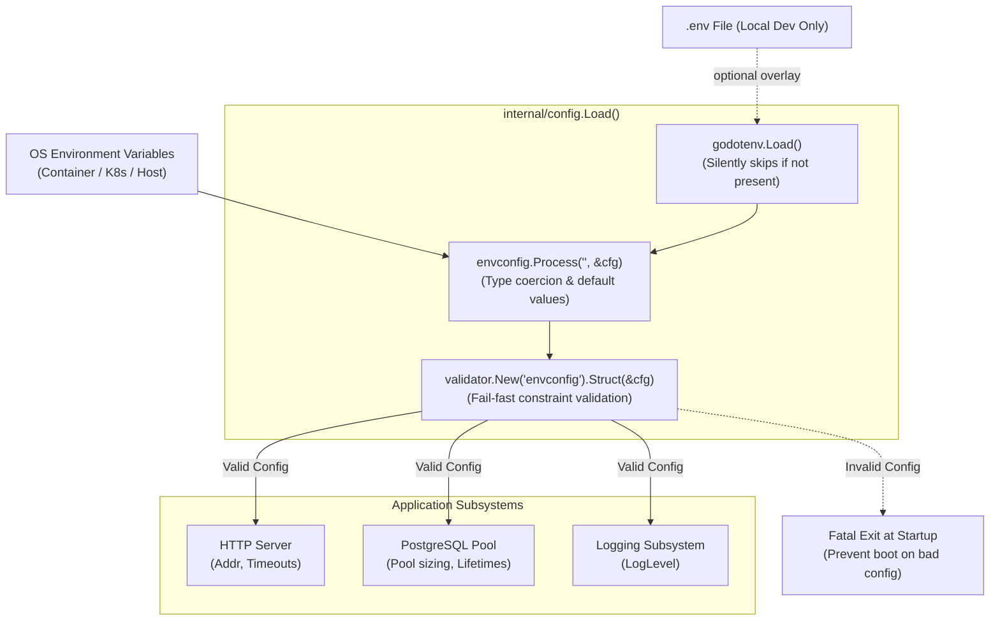

# ADR-0004: Application Configuration Management with envconfig, godotenv, and validator/v10

## Status
Accepted

## Date
2026-10-07

## Context
12-Factor application principles dictate that configuration must be strictly separated from code and stored in the execution environment. In Go microservices, configuration handling frequently suffers from common pitfalls:

1. **Unchecked / Ad-hoc `os.Getenv` Lookups**:
   - Scatter string-based environment parsing across different packages.
   - Lacks centralized schema definition, type parsing (e.g. `time.Duration`, integers), and fallback defaults.
2. **Missing Startup Validation (Late Failure)**:
   - Malformed configuration (e.g. invalid port number, missing database connection string, invalid log level) often goes unnoticed until runtime traffic hits the affected codepath.
3. **Heavyweight File-Based Configuration Engines (e.g., Viper)**:
   - Introduce bulky dependencies, complex config discovery logic (JSON/YAML/TOML merging), global state, and runtime type coercions that can obscure where a value came from.
4. **Local Developer Friction**:
   - Manually exporting environment variables before running services or tests locally leads to workstation setup friction and onboarding overhead.

We require a lightweight, type-safe, fail-fast configuration architecture that automatically maps environment variables to strongly typed Go structs, validates business and operational constraints at startup, and transparently supports `.env` files for local development without compromising cloud-native production environments.

## Decision
We adopt a centralized configuration architecture under `internal/config`, composed of:

1. **`kelseyhightower/envconfig`**: Clean declarative mapping of environment variables to Go struct fields using struct tags (`envconfig`, `default`).
2. **`joho/godotenv`**: Optional `.env` file loading for local development convenience. Missing `.env` files are ignored to ensure seamless execution in containerized and cloud environments.
3. **`go-playground/validator/v10`**: Strict struct validation at bootstrap via `validate` tags, guaranteeing fail-fast application startup if configuration constraints are violated.



---

### 1. Unified Configuration Schema (`internal/config/config.go`)
Configuration is captured in a single, strongly typed `Config` struct. Every field specifies its environment key, default value (where appropriate), and validation rules:

```go
type Config struct {
    Environment string `envconfig:"APP_ENV" default:"development" validate:"required,oneof=development staging production test"`
    HTTPPort    int    `envconfig:"HTTP_PORT" default:"8080" validate:"required,min=1,max=65535"`
    DatabaseURL string `envconfig:"DATABASE_URL" validate:"required"`
    LogLevel    string `envconfig:"LOG_LEVEL" default:"info" validate:"required,oneof=debug info warn error"`

    // HTTP Server settings
    ServerShutdownTimeout   time.Duration `envconfig:"SERVER_SHUTDOWN_TIMEOUT" default:"10s" validate:"required"`
    ServerReadHeaderTimeout time.Duration `envconfig:"SERVER_READ_HEADER_TIMEOUT" default:"30s" validate:"required"`

    // PostgreSQL pool settings
    DBMaxConns          int32         `envconfig:"DB_MAX_CONNS" default:"25" validate:"required,min=1"`
    DBMinConns          int32         `envconfig:"DB_MIN_CONNS" default:"2" validate:"min=0"`
    DBMaxConnLifetime   time.Duration `envconfig:"DB_MAX_CONN_LIFETIME" default:"30m" validate:"required"`
    DBMaxConnIdleTime   time.Duration `envconfig:"DB_MAX_CONN_IDLE_TIME" default:"5m" validate:"required"`
    DBHealthCheckPeriod time.Duration `envconfig:"DB_HEALTH_CHECK_PERIOD" default:"1m" validate:"required"`
    DBPingTimeout       time.Duration `envconfig:"DB_PING_TIMEOUT" default:"5s" validate:"required"`
}
```

---

### 2. Startup Lifecycle & Fail-Fast Guarantees
The `config.Load()` function executes in three deterministic stages:
1. **Local `.env` Lookup**: Calls `godotenv.Load()`. If the file does not exist (`os.ErrNotExist`), execution continues uninterrupted. If the file exists but has syntax/permission errors, startup fails immediately.
2. **Environment Variable Processing**: Calls `envconfig.Process("", &cfg)`, parsing strings into Go types (`int`, `time.Duration`, `string`) and injecting configured defaults for unset keys.
3. **Constraint Validation**: Uses `internal/adapter/validator` (wrapped around `validator/v10`) configured with the `"envconfig"` tag name strategy. Validates business constraints (`min=1,max=65535`, `oneof=...`, `required`). Any constraint violation returns an actionable, descriptive error and aborts process boot before any network listener or database pool is instantiated.

---

## Consequences

### Positive
- **Fail-Fast Startup**: Misconfigured or missing environment variables halt the service immediately with exact field-level diagnostics, preventing partial initialization or unexpected runtime failures.
- **Type-Safe & Self-Documenting**: All configuration keys, expected Go types, defaults, and boundary constraints are declared in a single, readable Go struct.
- **Zero Configuration Drift**: Removes the risk of code-level fallback values differing between handlers or adapters.
- **12-Factor Compliant**: Fully configurable across Kubernetes ConfigMaps, Secrets, Docker environments, and local shell sessions.
- **Frictionless Developer Experience**: Developers can drop a `.env` file into the root directory for local runs without needing to export variables or modify Dockerfiles.

### Negative
- **Validation Tag Learning Curve**: Developers adding new configuration parameters must declare both `envconfig` and `validate` tags consistently.
- **Environment Overrides Only**: Dynamic runtime reloading without process restart is intentionally not supported (standard for immutable containerized services).

### Neutral
- Secret credentials (such as `DATABASE_URL`) are read from the environment rather than external secret-provider SDKs, delegating secret injection to the platform (Kubernetes Secrets / Infisical / Vault Agent).

---

## Alternatives Considered

1. **`spf13/viper`**:
   - *Rejected*: Excessively heavy for 12-factor cloud-native applications. Its multi-source precedence hierarchy (files, flags, remote configs, env) complicates debugging and configuration tracking, and lacks built-in declarative struct tag validation.
2. **Direct `os.Getenv` Lookups**:
   - *Rejected*: Lacks type parsing, centralized defaults, and automatic struct binding. Leads to duplicated fallback logic and fragile string comparisons across application packages.
3. **Pure Flags (`flag` / `pflag` / `cobra`)**:
   - *Rejected*: Passing extensive connection pooling parameters, timeouts, and secrets as CLI flags in containerized deployments leaks parameters to process inspection tables (`ps aux`) and complicates standard container orchestration.

---

## References
- [12-Factor App: Config](https://12factor.net/config)
- [kelseyhightower/envconfig](https://github.com/kelseyhightower/envconfig)
- [joho/godotenv](https://github.com/joho/godotenv)
- [go-playground/validator](https://github.com/go-playground/validator)
- ADR-0001: Standardized Development Environment and Tooling Pipeline
- ADR-0003: PostgreSQL Persistence Layer Architecture with pgx/v5, sqlc, goose, and UUIDv7
