# ADR-0006: Local Development Workflow with Air Live-Reload and VS Code Delve Debugging

## Status
Accepted

## Date
2026-10-10

## Context
As the hotel-booking service codebase grows, local development efficiency relies heavily on fast feedback loops during implementation and reliable debugging facilities during root-cause investigation:

1. **Repetitive Manual Restart Cycle**:
   - Rebuilding and restarting the HTTP server manually (`go run ./cmd/server` or `go build`) after each code change introduces unnecessary friction and slows down iteration.
2. **Database and Migration Dependency**:
   - Running the server locally requires an active PostgreSQL instance and up-to-date Goose migrations. Forgetting to launch or migrate the database results in startup failures.
3. **Hot-Reload vs. Step Debugger Interference**:
   - Attempting to combine live-reload file watchers and headless Delve (`dlv`) instances within a single CLI task introduces severe operational issues: port contention (`bind: address already in use`), signal routing confusion across child processes, zombie processes, and broken debugger attachments on file modifications.
4. **IDE Debugging Friction**:
   - Developers need a zero-friction, standard debugging workflow inside their IDE (breakpoints, variable inspection, goroutine call stacks) without fighting external CLI process managers.

## Decision
We decouple the continuous live-reload development loop from the interactive debugging loop:

1. **Air for Live-Reloading (`mise run dev`)**:
   - We pin `github.com/air-verse/air` directly inside `go.mod` via the Go 1.24+ `tool` directive.
   - We configure Air via `.air.toml` to watch Go files, exclude test files (`_test.go`), generated assets (`internal/gen`, `docs`, `tmp`), and build the binary to `./tmp/main` with graceful interrupt signaling (`send_interrupt = true`).
   - We introduce the `mise run dev` task, orchestrating dependencies automatically: `docker compose up -d --wait` -> `go tool goose up` -> `go tool air`.
2. **VS Code Native Delve (`.vscode/launch.json`)**:
   - Delve debugging is delegated entirely to VS Code's official Go extension (`golang.go`), which invokes Delve on demand when launching a session (F5).
   - We provide standardized `.vscode/launch.json` targets for launching the server (`cmd/server`) and debugging individual test packages, pre-wired with `${workspaceFolder}/.env`.

```mermaid
graph TD
    subgraph LocalDev ["Local Development Flows"]
        direction TB

        subgraph FastLoop ["Live-Reload Cycle (mise run dev)"]
            Compose["docker compose up -d --wait<br/>(PostgreSQL)"] --> Migrate["go tool goose up<br/>(Apply Migrations)"]
            Migrate --> AirWatcher["go tool air<br/>(File Watcher & Runner)"]
            AirWatcher -->|"Watches *.go"| Rebuild["Rebuilds ./tmp/main on change"]
            Rebuild -->|"send_interrupt (SIGINT)"| GracefulRestart["Restart Server Process"]
        end

        subgraph DebugLoop ["Interactive Debugging (VS Code F5)"]
            VSCode["VS Code / Cursor"] --> Launch["launch.json<br/>(Debug Server)"]
            Launch --> NativeDlv["Native Delve (dlv)<br/>(go-delve/delve via golang.go)"]
            NativeDlv --> InteractiveDebug["Breakpoints, Variable Inspection,<br/>Goroutine Stacks"]
        end
    end
```

---

## Consequences

### Positive
- **Instant Developer Feedback**: Code edits immediately trigger recompilation and execution without manual restarts.
- **Hermetic Tooling**: `air` is managed via Go's native `tool` directive in `go.mod` and executed through `go tool air`, eliminating unpinned global installations across developer machines.
- **Zero Port Contention**: Live-reloading and step-debugging operate independently. Developers choose either fast hot-reloading (`mise run dev`) or full IDE debugging (F5).
- **One-Command Bootstrapping**: `mise run dev` automatically ensures PostgreSQL is healthy and migrations are applied before starting the service.

### Negative
- **Build Overhead on Save**: In large codebases, frequent rapid saves can cause recurring rebuilds. Mitigated by setting a 500ms debounce delay (`delay = 500`) in `.air.toml`.
- **Dual Process Running Risk**: Running `mise run dev` and launching the VS Code debugger simultaneously will cause an address conflict on port `:8080`. Developers must stop one before starting the other.

---

## Alternatives Considered

1. **Embedded Delve inside Air (`dlv exec` runner in Air)**:
   - *Rejected*: Running Delve under a hot-reloading process watcher drops active debug sessions on file save, leaves stale port allocations, and creates confusing multi-process signal handling between Air, Delve, and the application.
2. **Dedicated `mise run debug` CLI task calling `dlv debug`**:
   - *Rejected*: Headless terminal debugging via Delve CLI provides a degraded developer experience compared to native VS Code / IDE graphical debuggers. VS Code automatically manages the Delve lifecycle via `launch.json`.
3. **Global `air` and `dlv` Installation (`go install ...`)**:
   - *Rejected*: Violates ADR-0001 (reproducible tooling pipeline). All developer CLI utilities must be tracked in `go.mod` via the `tool` directive or managed via Mise.

---

## References
- [Air: Live reload for Go apps](https://github.com/air-verse/air)
- [VS Code Go Debugging Documentation](https://github.com/golang/vscode-go/blob/master/docs/debugging.md)
- ADR-0001: Standardized Development Environment and Tooling Pipeline
- ADR-0004: Application Configuration Management
