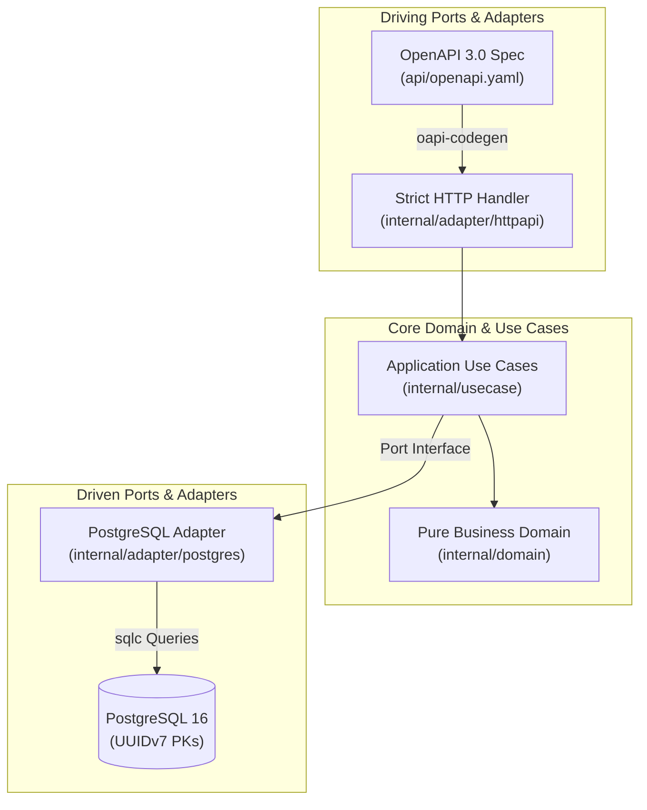

# Go Service Template

A production-grade, battle-tested Go microservice template built with **Hexagonal Architecture** (ports & adapters), **OpenAPI spec-first** code generation, **PostgreSQL** persistence with UUIDv7, hermetic toolchains (**Mise**), and a **zero-trust CI/CD pipeline**.

---

## Key Architectural Highlights



- **Spec-First API Contracts**: OpenAPI 3.0 specification drives typesafe HTTP router interfaces, parameters, and RFC 7807/9457 error models via `oapi-codegen`.
- **Hermetic Toolchains**: Reproducible developer environments and CI pipelines managed strictly through `mise` and Go tool directives—zero ambient dependency drift.
- **Type-Safe Persistence**: Pure SQL compilation with `sqlc`, versioned migrations with `goose`, high-performance connection pooling with `pgx/v5`, and time-ordered `UUIDv7` keys.
- **Zero-Trust CI/CD**: Gitleaks secret detection, govulncheck vulnerability audits, actionlint and zizmor workflow analysis, and minimal scratch production containers.

---

## Documentation Roadmap

| Section | Description |
| :--- | :--- |
| **[Folder Structure](folder-structure.md)** | Deep dive into hexagonal layers, dependencies, and file layout. |
| **[Tech Stack](tech-stack.md)** | Architectural justification for every library and developer tool. |
| **[CI/CD & Security](pipeline.md)** | Multi-stage verification pipeline, container provenance, and supply chain security. |
| **[Template Guide](template-guide.md)** | Step-by-step guide to instantiating, renaming, and adopting this template. |
| **[Decisions (ADRs)](decisions/0001-development-environment.md)** | Formal Architecture Decision Records documenting all major technical tradeoffs. |
| **[Technical Debts](techdebts/0001-ci-cache-poisoning.md)** | Explicit log of tracked technical compromises and their remediation paths. |

---

## Quickstart

### Prerequisites

- [Mise](https://mise.jdx.dev/) (manages Go runtime and dev tools)
- [Docker](https://docs.docker.com/get-docker/) & Docker Compose

### Running Locally

```bash
# 1. Install toolchain via mise
mise install

# 2. Copy the environment configuration template
cp .env.example .env

# 3. Start PostgreSQL and run migrations
mise run docker:compose-up
mise run migrate:up

# 4. Run the server
go run ./cmd/server
```

The server starts on `http://localhost:8080`:

- **Health check probe**: `GET http://localhost:8080/healthz`
- **Swagger UI**: `GET http://localhost:8080/docs/`
- **OpenAPI Specification**: `GET http://localhost:8080/openapi.json`
- **Items API**: `GET /api/v1/items`, `POST /api/v1/items`
